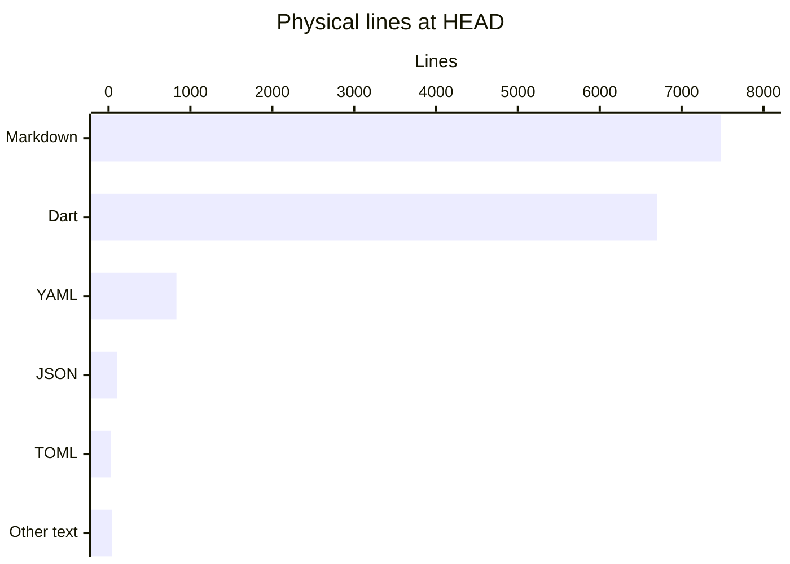

# By the numbers

Data collected on 2026-10-23, at commit `559f2b2192d495a17c5a966321085647a885564a`.

This is a measured snapshot, not a quality score. See [Architecture](overview/architecture.md) for the meaning of the components and [Lore](lore.md) for their history.

## Scope and counting rules

- The file inventory is `git ls-tree -r HEAD`, excluding `droid-wiki/`. Untracked files, installed dependencies, caches and generated wiki output do not contribute.
- A physical line is an LF-delimited line, plus a final nonempty unterminated line. Comments and blank lines count. These are **not executable source-line counts**.
- Language is classified by extension; YAML includes `.yaml` and `.yml`. `LICENSE` and `.gitignore` are the two “Other text” files. Embedded shell and Python in workflow YAML remain YAML.
- There is **one Dart package**, identified by the single tracked `pubspec.yaml`: `mythic_dice_parser`, version **8.3.0**. `example/` is not another package.

## Size and composition

**57 tracked files contain 15,172 physical lines.** Documentation is slightly larger than Dart source, tests and examples combined.

| Language / text format | Files | Physical lines |
| --- | ---: | ---: |
| Markdown | 16 | 7,476 |
| Dart | 23 | 6,698 |
| YAML | 10 | 829 |
| JSON | 4 | 101 |
| TOML | 2 | 29 |
| Other text | 2 | 39 |
| **Total** | **57** | **15,172** |



The same inventory, partitioned by purpose:

| Category | Files | Physical lines | Rule |
| --- | ---: | ---: | --- |
| Library source | 18 | 3,449 | All files under `lib/` |
| Tests | 3 | 3,006 | All files under `test/` |
| Example source | 2 | 243 | Dart files under `example/` |
| Configuration | 17 | 977 | Non-Markdown files in `.github/`, `.vscode/`, `.conductor/`, root package/analyzer/coverage/toolchain files and `.gitignore` |
| Documentation | 16 | 7,476 | Markdown, including `.github/RELEASES.md` and `example/README.md` |
| Legal | 1 | 21 | `LICENSE` |

The test-to-library physical-line ratio is **0.872:1** (3,006 / 3,449), excluding example code. It is not a coverage measurement. The three suites are `test/dart_dice_parser_test.dart`, `test/parity_8_2_0_test.dart` and `test/subtraction_push_test.dart`; see [Testing](how-to-contribute/testing.md).

### Average file length by directory

Each file belongs to its **immediate parent directory**, not every ancestor. Averages include all tracked text formats and are rounded to one decimal place.

| Directory | Files | Lines | Average lines/file |
| --- | ---: | ---: | ---: |
| Repository root | 14 | 1,492 | 106.6 |
| `.conductor/` | 1 | 27 | 27.0 |
| `.github/` | 1 | 59 | 59.0 |
| `.github/workflows/` | 7 | 792 | 113.1 |
| `.vscode/` | 2 | 85 | 42.5 |
| `doc/` | 3 | 2,512 | 837.3 |
| `doc/3d-dice-research/` | 5 | 3,487 | 697.4 |
| `example/` | 3 | 263 | 87.7 |
| `lib/` | 1 | 26 | 26.0 |
| `lib/src/` | 17 | 3,423 | 201.4 |
| `test/` | 3 | 3,006 | 1,002.0 |

## Recent activity

Activity counts **all commits reachable from HEAD**, including merges, grouped by **committer timestamp in UTC**. They do not count pushes, PRs or distinct changes. October and the final week stop at this snapshot.

| Month | Commits |
| --- | ---: |
| 2026-05 | 0 |
| 2026-06 | 11 |
| 2026-07 | 3 |
| 2026-08 | 2 |
| 2026-09 | 5 |
| 2026-10, through October 23 | 15 |

| Week beginning Monday | Commits |
| --- | ---: |
| 2026-08-31 | 0 |
| 2026-09-07 | 0 |
| 2026-09-14 | 0 |
| 2026-09-21 | 0 |
| 2026-09-28 | 7 |
| 2026-10-05 | 0 |
| 2026-10-12 | 0 |
| 2026-10-19, through October 23 | 13 |

### Ninety-day churn

The window is **2026-07-26 00:00 UTC inclusive to 2026-10-24 00:00 UTC exclusive**: 90 calendar days including the collection day. It contains **22 commits**, of which **18 are non-merge commits**.

For churn, sum `git diff-tree --numstat` additions and deletions for those non-merge commits, restricted to the **57 paths present at HEAD**, excluding `droid-wiki/`. Merge diffs are excluded to avoid counting their branch changes again. Removed agent-tooling paths that no longer exist at HEAD are deliberately outside this cohort. Rename inference is not used.

- **29 current files changed**.
- **3,001 lines added**, **342 deleted**.
- **3,343 lines of churn** (additions + deletions), **+2,659 net lines**.

| Current file | Added | Deleted | Churn |
| --- | ---: | ---: | ---: |
| `test/dart_dice_parser_test.dart` | 668 | 10 | 678 |
| `test/parity_8_2_0_test.dart` | 453 | 0 | 453 |
| `lib/src/parser.dart` | 170 | 93 | 263 |
| `.github/workflows/factory-triage.yml` | 173 | 0 | 173 |
| `README.md` | 152 | 6 | 158 |
| `lib/src/push.dart` | 98 | 54 | 152 |

This measures text edits, including formatting and test fixtures, not implementation effort.

## Explicit bot / AI attribution

A commit qualifies when its **author identity or a `Co-authored-by:` line** contains `[bot]`, matches Anthropic's automated no-reply identity, or has the display name exactly `Claude`, case-insensitively. Count each commit once, even when several matching trailers appear. Email addresses are not reproduced.

| Reachable-history scope | Attributed commits | All commits, including merges | Fraction |
| --- | ---: | ---: | ---: |
| Entire history through HEAD | 44 | 289 | 15.22% |
| Same 90-day window as above | 16 | 22 | 72.73% |

Across the full history, 15 commits qualify by author and 29 by coauthor trailer; these sets do not overlap here. In the 90-day window, all 16 qualify by coauthor trailer. For example, `604f59c` has an explicitly automated author, while `5143708` carries repeated `factory-droid[bot]` coauthor trailers but contributes only one commit to the numerator.

**This is a lower bound on explicitly recorded AI involvement, not the fraction of code written by AI.** Missing trailers, squash merges and human-authored commits with unrecorded assistance cannot be inferred. No individual contributor rankings are calculated.

## Public surface

The public-surface and import-graph measurements below are retained from the audit at `514370869cca91f91910cee58b7048425463147f`. A Git diff against this snapshot confirms that none of the tracked Dart files changed in the four newer commits; these metrics were not re-audited.

`lib/mythic_dice_parser.dart` directly exports **11 local libraries**, exposing **21 distinct named top-level declarations**:

- **12 classes:** `DiceExpression`, `DiceRoller`, `PreRolledDiceRollerExhaustedException`, `PreRolledDiceRoller`, `CallbackDiceRoller`, `RNGRoller`, `DiceResultRoller`, `DieScoreRule`, `GroupResult`, `RollResult`, `RollSummary`, `RolledDie`.
- **5 enums:** `DieType`, `OpType`, `CountType`, `CountComparison`, `PushLock`.
- **1 named extension:** `RolledDieIListExtensions`.
- **3 functions:** `reroll`, `rerollableDice`, `pprint`.

Method: follow the barrel's export directives, enumerate public top-level declarations in each target and deduplicate names. Do not count constructors, class/static/extension members, enum values, imported dependency declarations or private names. There are no further export directives in those targets. This is a textual declaration audit, not an analyzer-generated API compatibility report. Internal types such as `StatsCollector` and the AST operators are not counted. See [Data models](reference/data-models.md).

## Internal import graph

Resolving relative imports and `package:mythic_dice_parser/` imports across all **23 tracked Dart files** gives **63 distinct directed file-to-file import edges**. SDK and third-party imports are excluded. Export directives are intentionally not edges.

There are **two cyclic strongly connected components**, not “two individual cycles”:

| Component | Files, all under `lib/src/` |
| --- | --- |
| Grammar / AST, 5 files | `ast_core.dart`, `ast_dice.dart`, `ast_ops.dart`, `dice_expression.dart`, `parser.dart` |
| Results / rollers / scoring, 6 files | `dice_roller.dart`, `die_score_rule.dart`, `extensions.dart`, `push_lock.dart`, `roll_result.dart`, `rolled_die.dart` |

An exhaustive search finds a **longest simple import chain of 10 edges, or 11 distinct files**. One maximum chain, with every filename below rooted at `lib/src/`, is:

```text
ast_dice.dart -> ast_core.dart -> dice_expression.dart -> parser.dart
  -> ast_ops.dart -> dice_roller.dart -> roll_result.dart -> extensions.dart
  -> rolled_die.dart -> die_score_rule.dart -> enums.dart
```

“Simple” means no file is revisited. Cycles make an unrestricted walk unbounded. Excluding barrel exports means test/example imports of the barrel do not continue through its exported libraries. These are static dependency facts, not execution depth, runtime recursion or proof of a defect. See [Systems](systems/index.md).

## Evidence

Current size measurements come from Git tree blobs at the snapshot commit under `lib/`, `test/`, `example/`, `doc/`, `.github/`, `.vscode/`, `.conductor/` and root files, not staged or untracked wiki artifacts. Package/API facts come from `pubspec.yaml` and `lib/mythic_dice_parser.dart`, with the unchanged API and import-graph audit retained as noted above. Activity and attribution come from the 289-commit reachable Git history, rather than filesystem modification times.
