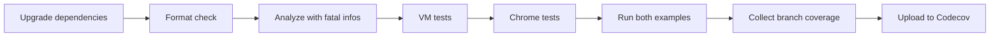

# Automation and publishing

This repository ships a Dart library, not a deployed service. `pubspec.yaml` configures GLPub publishing; the seven workflows under `.github/workflows/` run validation, wiki refresh, four native Factory automations, and Release Please.

## Dart validation

`.github/workflows/dart.yml` runs on pushes and pull requests targeting `main`, plus a weekly Sunday schedule. It uses the latest stable Dart SDK.

The workflow activates the coverage tool during the run, and `codecov.yml` contains an ignore entry. There is no SDK matrix, package publishing step, or deployment rollback job. See [Testing](how-to-contribute/testing.md).

## Release Please

`.github/workflows/release-please.yml` runs on pushes to `main` and manual dispatch. Its job also requires `refs/heads/main`, so a manual dispatch on another branch does not run the release job. Runs share the `release-please` concurrency group without cancelling in-progress runs.

`release-please-config.json` defines one root component, `mythic_dice_parser`, using the `dart` strategy. `.release-please-manifest.json` records the 8.3.0 baseline, matching `pubspec.yaml`. Release Please updates `pubspec.yaml`, `CHANGELOG.md`, and the manifest, then creates a GitHub release and tag when its release PR is merged. Tags use `vVERSION` without a component prefix.

The configured `bootstrap-sha` is `60347fad56132bd939adee0dc4f3243a7b8ced8f`. `.github/RELEASES.md` notes that neither `v8.2.0` nor `v8.3.0` exists for this setup. The initial scan uses the bootstrap when no matching earlier tag is found; a matching earlier tag can take precedence, so inspect the first release PR's diff and changelog against the baseline and earlier tags. The first run may have nothing to release.

### Credentials and verification

The required Actions secret is `RELEASE_PLEASE_TOKEN`; there is no `GITHUB_TOKEN` fallback. `.github/RELEASES.md` prescribes a fine-grained token scoped to this repository under `Jason-Holt-Digital`, with Contents, Pull requests, and Issues read/write access and organization approval if required. The workflow's `contents: read` permission does not grant or restrict the supplied token's own permissions.

The credential preflight fails if the secret is absent, then uses `gh api --silent "repos/$GITHUB_REPOSITORY"` to check repository read access. It does not verify write scopes or prove that a release can be created. No actual credentials or configured secret values were inspected for this wiki.

`fix:` and `feat:` commits trigger releases. Breaking changes use `!` after the type or a `BREAKING CHANGE:` footer; squash titles must follow the same convention. `chore:` alone does not trigger a release. Verify the setup with a real qualifying change: inspect the release PR and its checks, merge it when ready, and confirm the GitHub release and `v` tag. A green no-op run is insufficient; do not create dummy releases.

### GLPub publication boundary

`pubspec.yaml` sets `publish_to: https://glpub.dev/api/p/default/pub`. No checked-in workflow automates `dart pub publish`; Release Please does not add a GLPub publisher.

Treat package publication and its credentials as a separate, explicitly authorized operation. Updating a version, passing CI, or creating a GitHub release does not publish the package. Follow `.github/RELEASES.md` for release operations and `CHANGELOG.md` for compatibility changes, especially the 8.3.0 count grammar.

## Wiki refresh

`.github/workflows/droid-wiki-refresh.yml` runs on `main` pushes and serializes refreshes per repository. Its generation job has read-only repository permissions, checks out full history, and restores `droid-wiki/` from the rolling `factory/droid-wiki` branch when available.

The generation job invokes `/wiki` and passes Markdown plus hidden metadata to a separate publish job. Video and images are excluded from Git artifacts and commits. The publish job writes the rolling branch and opens or updates a documentation pull request against the default branch.

`FACTORY_WIKI_PR_TOKEN` is optional; the workflow falls back to the built-in GitHub token. The comments warn that pull requests created by that fallback do not trigger other workflows. Push/PR failures in the publish step are reported as warnings rather than discarding generated documentation.

## Native Factory workflows

These are the checked-in controls, not a claim that the repository variables are currently enabled:

| Workflow | Enable variable | Behavior |
| --- | --- | --- |
| `.github/workflows/factory-review.yml` | `JHD_FACTORY_REVIEW_ENABLED` | Advisory deep code and security review for authorized same-repository, non-draft PRs |
| `.github/workflows/factory-mentions.yml` | `JHD_FACTORY_MENTIONS_ENABLED` | PR-only commands from authorized human repository writers |
| `.github/workflows/factory-triage.yml` | `JHD_FACTORY_TRIAGE_ENABLED` | Classify a new issue and post a bounded suggestion |
| `.github/workflows/factory-ci-steward.yml` | `JHD_FACTORY_STEWARD_ENABLED` | Diagnose failed or timed-out Dart PR runs; bounded retries and optional fixes |

The steward's separate `JHD_FACTORY_STEWARD_FIX_ENABLED` controls auto-fix. Its instructions prohibit weakening checks, editing workflow/security/publishing policy, tagging, releasing, or deploying. Review and mentions use authorization jobs before jobs with comment permissions.

Triage separates read-only classification from comment publication. It permits only fixed categories and known candidate issue numbers, revalidates the issue's update time, and uses a marker to avoid duplicate comments. The duplicate search is limited to recently updated issues/PRs, not an exhaustive repository search.

See [Input boundaries](security.md) for trust boundaries and [Configuration](reference/configuration.md) for the release settings and CI control names.

## Source map

| File | Purpose |
| --- | --- |
| `.github/workflows/dart.yml` | Format, analyze, test, examples, coverage |
| `.github/workflows/droid-wiki-refresh.yml` | Read-only generation and separate wiki PR job |
| `.github/workflows/factory-review.yml` | Gated advisory review |
| `.github/workflows/factory-mentions.yml` | Authorized PR commands |
| `.github/workflows/factory-triage.yml` | Bounded classification and comment jobs |
| `.github/workflows/factory-ci-steward.yml` | Bounded Dart CI repair policy |
| `.github/workflows/release-please.yml` | Main-only release PRs, releases, and credential preflight |
| `release-please-config.json`, `.release-please-manifest.json` | Dart release strategy, bootstrap, tags, and baseline |
| `.github/RELEASES.md` | Token setup, commit conventions, and release verification |
| `pubspec.yaml` | Package identity and publishing destination |
