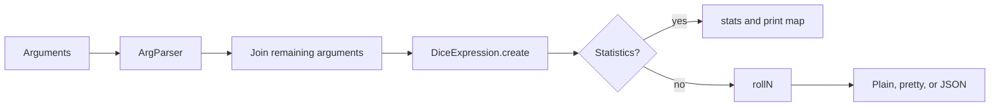

# Example CLI

Active contributors: Jason, Steve

## Purpose

`example/main.dart` runs formulas from the terminal and prints summaries, result trees, JSON, or sampled statistics. It is an example program, not a published executable under `bin/`.

## Commands and options

```bash
dart run example/main.dart -n 3 -o pretty '4d6kh3'
dart run example/main.dart -o json -r 42 '"Attack": 2d6, "Damage": 1d8'
dart run example/main.dart -s -n 1000 '2d6'
```

| Option | Default | Effect |
| --- | --- | --- |
| `-n`, `--num` | `1` | Number of rolls or statistics samples |
| `-o`, `--output` | `plain` | `plain`, `pretty`, or `json` |
| `-r`, `--random` | `pseudo` | Pseudo-random, `secure`, or an integer seed |
| `-v`, `--verbose` | false | Root logging at FINEST |
| `-s`, `--stats` | false | Collect sampled totals rather than print each roll |
| `-h`, `--help` | false | Print usage and exit with usage status |

Quote the entire formula to keep the shell from interpreting parentheses, `*`, or comparison characters. Labels need double quotes inside the single-quoted shell argument.

## How it works



The top-level `main()` parses flags, chooses an RNG, builds the expression, and calls `run()`. `run()` uses `rollN()` for ordinary output and `stats()` for simulation.

Statistics mode replaces the selected RNG with a fresh `Random()`. A requested seed therefore does not make `-s` deterministic. When the parsed roll count is 1, statistics mode substitutes 10,000; `-s -n 1` cannot request a single sample through this interface.

Plain output uses `RollSummary.toString()`; pretty output includes the result tree; JSON uses `json.encode()` and the models' `toJson()` methods. Zero, false, and empty fields are often omitted, so output is not a complete persistence format. See [Results](../systems/results.md).

## Error handling

`example/main.dart` prints invalid RNG input and exits with `ExitCode.usage`. Missing formulas exit with `ExitCode.noInput`; help also exits with the usage code rather than success. The formula creation/run block catches `FormatException` and exits with no-input status.

Argument parsing happens outside that catch, and errors such as range failures are not handled by it. Do not assume every invalid invocation has the same formatted error path.

## Integration and modification

Change CLI options and output selection in `example/main.dart`. Use `example/simple.dart` for a smaller seeded demonstration with assertions and result-tree traversal. Run it with `--enable-asserts`.

The example subsystem has two Dart files and one readme. `analysis_options.yaml` excludes the examples from static analysis, but `.github/workflows/dart.yml` still formats and runs both programs. Tests cover the library, not a separate CLI integration harness.

## Key source files

| File | Purpose |
| --- | --- |
| `example/main.dart` | Console argument parsing and output |
| `example/simple.dart` | Seeded rolls and assertion-based traversal |
| `example/README.md` | Small usage example |
| `.vscode/launch.json` | Example debugging launch profiles |

See [Getting started](../overview/getting-started.md) and [Events and statistics](events-and-statistics.md).
