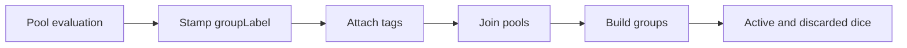

# Groups and tags

Active contributors: Jason

## Purpose

Labels retain the identity of separate dice pools in one formula. Tags carry key-value metadata through the result tree and into labeled groups. The grammar is in `lib/src/parser.dart`, and group assembly is in `lib/src/roll_summary.dart`.

## A grouped roll

```dart
final summary = await DiceExpression.create(
  '"Attack": 4d6kh3 @type=physical, "Damage": 1d8 @type=fire',
  roller: PreRolledDiceRoller([1, 3, 5, 6, 4]),
).roll();

print(summary.groups!['Attack']!.total); // 14
print(summary.groups!['Attack']!.discarded.length); // 1
print(summary.groups!['Damage']!.tags!['type']); // fire
```

The label colon is **outside** the closing quote: `"Attack":`, not `"Attack:"`. Some comments and expression rendering in `lib/src/ast_core.dart` still use the older spelling; parsed source syntax is defined by `lib/src/parser.dart`.

## Key abstractions

| Type | Source | Role |
| --- | --- | --- |
| `LabelOp` | `lib/src/ast_core.dart` | Copies labels onto active and discarded dice |
| `TagOp` | `lib/src/ast_core.dart` | Attaches metadata and stamps per-die push locks |
| `CommaOp` | `lib/src/ast_core.dart` | Chooses identity-preserving or totalized mode |
| `GroupResult` | `lib/src/group_result.dart` | Immutable group dice and metadata, with computed totals |
| `RollSummary` | `lib/src/roll_summary.dart` | Builds labeled groups and harvests tags |

## How it works



`LabelOp` stamps both active and discarded dice. `CommaOp` checks both lists on both sides for labels. If any are present, it concatenates individual dice; otherwise it collapses each operand to a synthetic total. Thus `2d6, 1d8` behaves differently from `"Attack": 2d6, "Damage": 1d8`, even when their numerical totals agree.

`RollSummary._buildGroups()` groups active and discarded dice by `groupLabel`. A group whose entire pool was dropped remains visible through its discarded dice. Unlabeled dice in a mixed labeled expression use the empty-string group. With no labels at all, `groups` is null, even if tags exist.

## Tag syntax and scope

Tag keys contain letters; values are nonempty and stop at a space, comma, `)`, or `}` in `lib/src/parser.dart`. Side-by-side tags form one map, so the last repeated key wins. An enclosing `TagOp` merges with existing node tags.

Ordinary tags are metadata. `@push=N` and `@lock=s|sf|none` also affect push behavior and are validated while parsing. The minimum push limit across the tree wins; an inner pool's lock rule wins over an enclosing one. See [Push](push.md), rather than inferring game rules from group metadata alone.

For unlabeled formulas, inspect `summary.detailedResults.tags` or the relevant descendant node. `lib/src/roll_summary.dart` harvests tags by walking the result tree, including labels found only among discarded dice.

## Integration and modification

Change accepted syntax in `lib/src/parser.dart`, stamping in `lib/src/ast_core.dart`, and group/tag harvesting in `lib/src/roll_summary.dart`. Keep the all-discarded regression cases in `test/dart_dice_parser_test.dart`: losing those labels changes comma behavior as well as group display.

This feature spans four main source files and shares the main test suite with other capabilities, so it has no separately attributable test-to-code ratio. Recent default-branch changes are by Jason; this is not a formal ownership assignment.

## Key source files

| File | Purpose |
| --- | --- |
| `lib/src/parser.dart` | Label and tag tokens |
| `lib/src/ast_core.dart` | Label/tag evaluation and comma modes |
| `lib/src/roll_summary.dart` | Group building and tag harvesting |
| `lib/src/group_result.dart` | Group interface and JSON |
| `test/dart_dice_parser_test.dart` | Labels, all-discarded groups, tags, immutability |

See [Results](../systems/results.md) for serialization and [Custom dice](custom-dice.md) for reusable face sets.
