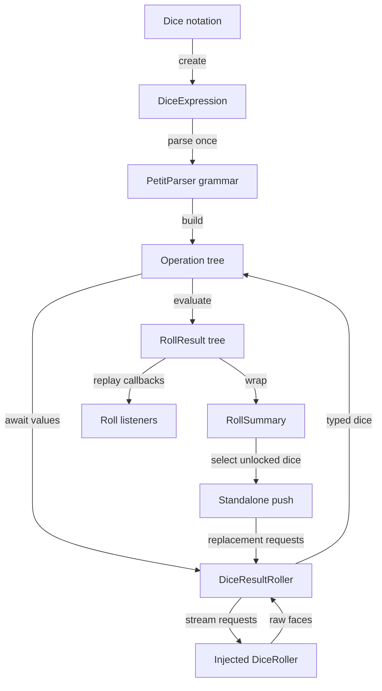

# Architecture

Parsing is synchronous; rolling is asynchronous. The parser builds reusable operations, evaluation produces a result tree, and a summary exposes the final dice and derived information. The implementation is Dart throughout, with 18 library files, three test files, and two example programs.

## Language footprint

The tracked checkout contains 6,698 physical Dart lines across library, tests, and examples. Supporting text includes 7,468 Markdown lines, 829 YAML lines, 101 JSON lines, and 29 TOML lines. These counts exclude the generated wiki and include comments and blank lines; see [By the numbers](../by-the-numbers.md) for methods and history metrics.

## Formula lifecycle

`lib/src/dice_expression.dart` owns creation, repeated rolls, listeners, and statistics. `lib/src/parser.dart` constructs nodes from `lib/src/ast_core.dart`, `lib/src/ast_dice.dart`, and `lib/src/ast_ops.dart`. AST nodes call child expressions and return `Future<RollResult>`.

## Component boundaries

| Component | Source | Responsibility |
| --- | --- | --- |
| Public API | `lib/mythic_dice_parser.dart` | Exports supported result, roller, scoring, and push types |
| Grammar | `lib/src/parser.dart` | Token recognition, precedence, AST construction |
| Core operations | `lib/src/ast_core.dart` | Arithmetic, labels, tags, comma, aggregate |
| Dice and modifiers | `lib/src/ast_dice.dart`, `lib/src/ast_ops.dart` | Roll and transform typed dice |
| Roller boundary | `lib/src/dice_roller.dart` | Convert raw values into domain results |
| Result model | `lib/src/rolled_die.dart`, `lib/src/roll_result.dart`, `lib/src/roll_summary.dart` | Preserve dice identity and evaluation details |
| Push | `lib/src/push.dart` | Replace unlocked dice with their original scoring rules |

There is no database or network API in this flow. The five runtime dependencies in `pubspec.yaml` are local libraries: PetitParser, immutable collections, Equatable, collection helpers, and logging.

## Evaluation order and events

Binary operations in `lib/src/ast_core.dart` await the left child before the right child. An asynchronous roller can wait for external input, but independent AST branches are not evaluated concurrently. Extra rolls from explosions or rerolls occur when the relevant modifier evaluates.

Listeners in `lib/src/dice_expression.dart` walk the completed result tree in child-first order, skipping value nodes. They are not progressive “about to roll” callbacks. An interactive application should handle on-demand input through [Rollers](../systems/rollers.md), not wait for listener replay.

## Identity versus totals

`lib/src/rolled_die.dart` models individual faces and transformation flags. Addition preserves result lists; multiplication, aggregate braces, plain counts, and unlabeled comma operands create synthetic constants. Labeled comma expressions preserve individual dice. These choices determine which dice can later be pushed.

Subtraction normally preserves negative, flagged right-side dice. `foldSubtractions()` in `lib/src/ast_core.dart` folds right-side dice into constants under die-reading operators or nested right-side subtraction. See [Operators](../systems/operators.md) and [Push](../features/push.md).

`lib/src/roll_summary.dart` builds groups from both active and discarded labeled dice. Immutable lists and unmodifiable maps protect result snapshots; `from`, scoring rules, and push-lock rules are intentionally omitted from die JSON. See [Results](../systems/results.md).
