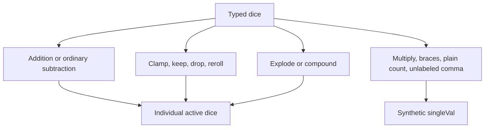

# Operators
Active contributors: Jason

## Purpose

AST operators evaluate notation into typed dice and a `RollResult` tree. They decide whether an operation preserves individual dice, changes them, discards them, or replaces a pool with a synthetic value. That choice determines what applications can inspect and what remains [pushable](../features/push.md).

## Key abstractions

| Abstraction | Responsibility | Source |
|---|---|---|
| `DiceOp`, `Unary`, `Binary` | Async evaluation and expression structure | `lib/src/ast_core.dart` |
| `UnaryDice`, `BinaryDice` | Operators with access to the typed roller | `lib/src/ast_core.dart` |
| `StdDice`, special-die nodes | Interpret operand totals and request typed dice | `lib/src/ast_dice.dart` |
| `CountOp`, transformation nodes | Score, filter, replace, extend, and order dice | `lib/src/ast_ops.dart` |
| `foldSubtractions()` | Preserve legacy die-reading behavior and avoid subtracting physical dice twice | `lib/src/ast_core.dart` |

`DiceOp.call()` awaits `eval()` and logs the result. Binary implementations evaluate the left operand before the right; extra rolls happen afterward in operator-specific loops. Do not parallelize children without considering [roller request order](rollers.md).

## Dice construction

`StdDice` evaluates both operands, defaulting an empty count or side operand to one, then validates count and sides before calling the adapter. The default one-sided result is invalid under the two-side minimum, so `6d` fails during evaluation rather than becoming a usable d1.

Special nodes share the evaluated-count pattern:

| Form | Interpretation |
|---|---|
| `dF` | Select from `[-1, -1, 0, 0, 1, 1]` |
| `d%` | Standard 100-sided die with percent operation metadata |
| `D66` | Two d6 digits, read as tens and ones |
| `d[2,3,5,7]`, named dice | Select from explicit face lists; duplicates weight outcomes |
| `d6p`, `d6p4` | A maximum triggers penetration rolls, subtracting one per extra roll |

Penetration accumulates into one die rather than adding independent active results. It retains its component rolls as discarded metadata and stops after the shared default iteration limit. Named-die registration and resolution are covered in [Custom dice](../features/custom-dice.md).

## Identity versus synthetic totals

Addition concatenates the operands' dice, retaining each die's own type and size. It does not convert mixed d6/d10 pools to one common die size, despite an older comment in `lib/src/roll_result.dart`.

Ordinary subtraction keeps RHS dice active, negates their numeric results, and marks them `subtracted`. A RHS d6 showing three contributes `-3` but is still a d6 that can be pushed. Score-count getters exclude subtracted dice.

Multiplication collapses the product into `RolledDie.singleVal`. Braces similarly produce one `singleVal` with `totaled: true`. An unlabeled comma totalizes each side; a comma with any labeled active **or discarded** die preserves individual dice. An entirely discarded labeled pool therefore does not lose its group identity. See [Groups and tags](../features/groups-and-tags.md).

### Folded subtraction

Not every subtraction preserves RHS dice individually. `SubOp` folds every subtraction inside its right operand. The parser also folds subtractions beneath operators that read dice individually: count/score, keep/drop, clamp, reroll, explode, and compound.

A folded subtraction emits the LHS dice plus **one negative RHS-total constant**, moving RHS active dice to discarded. For example, `(2d6 - 2d6)#` counts three entries, not four: two left dice and one synthetic negative total. Nested subtraction keeps the correct arithmetic total without carrying an already-subtracted physical die into another subtraction. Sorting alone does not trigger this fold.

This is intentional compatibility behavior. A total can stay unchanged while push eligibility, labels on synthetic values, or score flags differ. Preserve both numeric and structural assertions when editing it.

## Transformation semantics

Keep/drop selects dice into active and discarded lists; high/low variants sort while selecting and default to one. `C<5` raises lower faces to five; `C>15` lowers higher faces to fifteen and records clamp flags.

`r` replaces matching faces until the condition fails or the limit is reached; `ro` allows one replacement. `!` retains the triggering die and adds separate explosion dice. `!!` sums extra rolls into the original die, recording components as discarded. Explode and compound default to each die's maximum and skip non-explodable `singleVal` dice. The default limit is 1,000 iterations per triggering die, not a whole-expression budget.

Bare `#` produces a constant count. Scoring forms retain dice, set independent success/failure/critical flags, and record `DieScoreRule` on every inspected die, matched or not. A bare success scores the modeled maximum; a bare failure scores the modeled minimum. A single-face value is not automatically either, although an explicit target can match it. Scoring partitions matching dice first; `s`/`sd` sort both active and discarded lists.

## Modification and validation

Add syntax in [Parser](parser.md), implement evaluation here, and update [result metadata](results.md) deliberately. Copies preserve recorded scoring rules; newly created dice do not inherit unrelated rules. Push replays scoring only, never these transformations.

Use `test/dart_dice_parser_test.dart` for modifier and identity expectations, `test/subtraction_push_test.dart` for both-side push and nested subtraction, and `test/parity_8_2_0_test.dart` for compatibility fixtures.

## Scope snapshot

The three implementation files below contain 1,178 physical lines. Their `origin/main` current-path history has one unique human author, excluding automated authors and without following predecessor filenames. The shared three-file `test/*.dart` corpus has 3,006 physical lines, an overlapping 2.55:1 test-to-source ratio, not operator-only coverage. Counts include comments and blanks at `5143708`.

## Key source files

| File | Start here for |
|---|---|
| `lib/src/ast_core.dart` | Base nodes, arithmetic, comma, labels/tags, folding |
| `lib/src/ast_dice.dart` | Standard and special dice |
| `lib/src/ast_ops.dart` | Counting, sorting, modifiers, extra-roll loops |
| `lib/src/roll_result.dart` | Arithmetic result construction |
