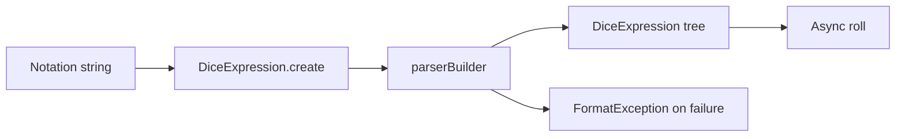

# Parser
Active contributors: Jason

## Purpose

The parser converts notation into an executable expression tree without rolling any dice. `DiceExpression.create()` in `lib/src/dice_expression.dart` constructs a `DiceResultRoller`, passes it into `parserBuilder()`, and requires the complete input to parse. Syntax failures become `FormatException` with the original input and failure position. Evaluation is a separate asynchronous step, described in [Architecture](../overview/architecture.md).

## Key abstractions

| Abstraction | Responsibility | Source |
|---|---|---|
| `parserBuilder()` | Builds the PetitParser expression grammar and AST nodes | `lib/src/parser.dart` |
| `_operandStart`, `_expressionStart` | Lookahead guards against empty arithmetic operands, groups, labels, and comma tails | `lib/src/parser.dart` |
| `_arithmeticOperator()`, `_signed()` | Recognize one optional RHS sign and construct signed operands | `lib/src/parser.dart` |
| `DiceExpression.create()` | Public synchronous parse entry point and error conversion | `lib/src/dice_expression.dart` |
| Named-die registry | Resolves registered face lists while parsing | `lib/src/dice_expression.dart` |

## Precedence and operands

Parentheses recursively contain an expression; braces also contain an expression but create an `AggregateOp` that totalizes its outcome. Outside wrappers, grammar groups run from tighter to looser binding:

| Tier | Forms |
|---|---|
| Special dice | `dF`, `D66`, `d%`, `d[...]`, `d6p`, registered lowercase names |
| Standard dice | Binary `d`, with expression-valued operands |
| Compounding | `!!`, optional once/comparison forms |
| Dice transformations | Reroll, explode, clamp, comparison drop, high/low drop and keep |
| Count and sort | `#`, `#s`, `#f`, `#cs`, `#cf`, `s`, `sd` |
| Multiplication | `*` |
| Addition and subtraction | `+`, `-` |
| Labels, tags, comma | `"Name":`, `@key=value`, `,` |

The primitive integer parser deliberately accepts an empty token. This supports omitted dice counts (`d6`) and omitted modifier counts (`4d6kh`). It also means the empty top-level expression remains valid and rolls to zero. The lookahead guards prevent that permissiveness from accepting `2d6+`, `2d6,`, `()`, `{}`, `"Damage":`, or nested empty operands.

Arithmetic accepts one optional signed RHS, including whitespace: `2d6 + - 1`, `2d6++3`, `2d6--1`, and `2d6*-1`. A sign is translated to addition or subtraction from an empty value rather than a separate unary-number AST type.

## Count literals and sort in 8.3

Count targets are optional **signed integer literals**, not arbitrary expressions. A potential target immediately followed by `d` or `D` is rejected as a target so it can begin a separate dice operand.

| Formula | Meaning |
|---|---|
| `4d10#>=6+2` | Count faces at least six, then add two |
| `2d6+1d6#` | Add the first pool to the count of the right pool |
| `(2d6+1d6)#` | Count all three dice |
| `2d6#s-2d6#s` | Subtract two independently scored pools |
| `2d6#s>=+5` | Score faces at least positive five |
| `4d6#+1` | Count faces equal to positive one |

Count and sort share a postfix tier and can interleave: `2d6s#s6` and `2d6#s6s` are accepted. Scoring may partition matching dice ahead of other dice, so sorting before scoring does not guarantee the final order. A keep after scoring needs parentheses: `(2d20#cf#cs)kh`, not `2d20#cf#cskh`.

Count, keep/drop, clamp, reroll, explode, and compound construction invokes `foldSubtractions()` on the operand. Sort does not. This is a semantic compatibility boundary, not just syntax normalization; see [Operators](operators.md).

## Metadata and extension guidance

Use `"Attack": 2d6`: the colon is outside the closing quote. Some AST display strings still show the older shape, so do not use `toString()` as a guaranteed parseable serialization.

Tags have letter-only keys and nonempty values terminated by a space, comma, `)`, or `}`. A consecutive tag run becomes one map, with the last duplicate key winning. `@push` requires an integer at least one; `@lock` accepts exactly `s`, `sf`, or `none`. Other keys remain client metadata. See [Groups and tags](../features/groups-and-tags.md) and [Push](../features/push.md) for runtime scope.

Place new dice forms before generic `d` when they share a prefix. Named dice resolve at parse time, accept lowercase names in formulas, and capture the registered faces in the AST. Registering names normalizes case, but does not make uppercase formula names valid.

When changing tiers, add deterministic tests for both parenthesized and unparenthesized formulas, signed targets, dangling operands, and modifier defaults. `test/subtraction_push_test.dart` fixes the 8.3 count behavior; `test/parity_8_2_0_test.dart` checks preserved outcomes but intentionally excludes changed formulas. See [Testing](../how-to-contribute/testing.md).

## Scope snapshot

The two source files below contain 431 physical lines. Their `origin/main` current-path history has two unique human authors, excluding automated authors and without following renames; recent human changes identify Jason above. The three shared `test/*.dart` files contain 3,006 physical lines: an overlapping test-to-source ratio of 6.97:1, not parser-only coverage. Counts include comments and blank lines at `5143708`.

## Key source files

| File | Start here for |
|---|---|
| `lib/src/parser.dart` | Grammar tiers, guards, target literals, tags |
| `lib/src/dice_expression.dart` | Parse entry point and registry |
| `test/subtraction_push_test.dart` | Count-literal and keep-after-count regressions |
| `test/dart_dice_parser_test.dart` | Signed operands, invalid input, notation examples |
