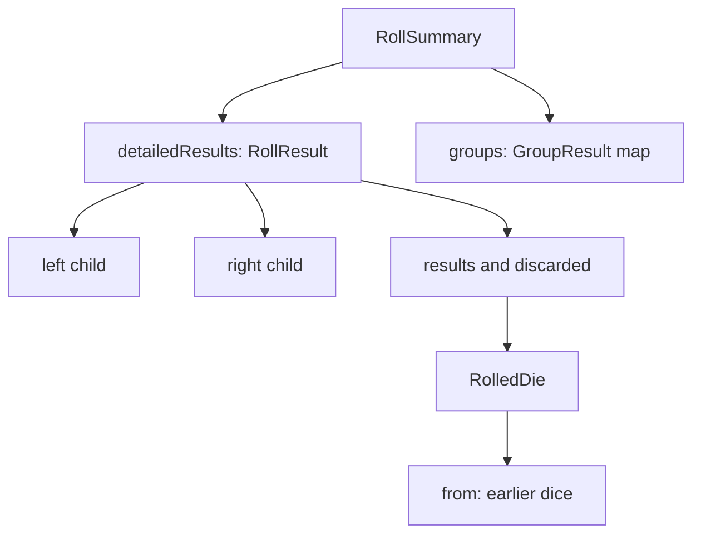

# Results
Active contributors: Jason

## Purpose

Results expose both the current outcome and the history needed to explain it. Applications usually render `RollSummary`, inspect its active and discarded dice, and optionally traverse `detailedResults`. The structures also carry the per-die state needed for [push](../features/push.md), so a numeric total alone is not an equivalent result.

## Key abstractions

| Abstraction | Responsibility | Source |
|---|---|---|
| `RolledDie` | One typed face or synthetic value, flags, provenance, group, push state | `lib/src/rolled_die.dart` |
| `RollResult` | One evaluated AST node with active/discarded dice and child pointers | `lib/src/roll_result.dart` |
| `RollSummary` | Root outcome, groups, counts, push count and limit | `lib/src/roll_summary.dart` |
| `GroupResult` | Labeled subset with computed totals and counts | `lib/src/group_result.dart` |
| `RolledDieIListExtensions` | Shared sum and score-count definitions | `lib/src/extensions.dart` |

## Die identity and metadata

A `RolledDie` retains its `DieType`, side count or explicit potential values, result, and modeled minimum/maximum. `singleVal` represents constants and collapsed operations rather than a rollable die. Constructors enforce required metadata, such as nonempty potential values for `nvals`, but are not a general face-range validator.

Flags distinguish active transformations and their components: `exploded` versus `explosion`, `compoundedFinal` versus `compounded`, `reroll` versus `rerolled`, penetration, clamp ceiling/floor, discard, and totalization. Success, failure, and critical flags are independent. A critical success does not implicitly set ordinary success; formulas can explicitly apply both scoring operators.

`RolledDie.copyWith()` creates a new die and normally sets `from` to the original die. Callers can supply a different provenance list. Copies preserve scoring rules, group label, lock policy, and subtraction state unless replaced. The API's nullable override parameters generally mean “retain the old value,” not “clear this field.”

For RHS subtraction, `result` is negated and `subtracted` is true. On custom or fudge dice, a negative physical face can therefore yield a positive numeric contribution. `isMaxResult` interprets the physical face by undoing the subtraction sign. Do not infer subtraction from `result < 0` alone.

`scoreRules` lists the scoring operators that inspected the die, innermost first, including nonmatches. `pushLock` records the innermost applicable `@lock` policy. `locked` is persistent push state, not merely a display classification.

## Result trees, totals, and groups

`RollResult` contains `results`, `discarded`, `left`, `right`, `opType`, an expression string, and optional tags. Operators may preserve children while replacing their active outcome with a synthetic total. Consequently, summing every node in the tree double-counts work. Sum the root's active results or use `summary.total`.

All total and count calculations use shared definitions:

- `total` sums numeric contributions, including subtracted results.
- Success, failure, and critical counts count only flagged **non-subtracted** active dice.
- They do not subtract RHS successes from LHS successes.
- `totalOrDefault()` uses its fallback only when the result list is empty, not when its sum happens to be zero.

`RollSummary` snapshots root values and builds an unmodifiable group map when active or discarded dice have labels. Unlabeled dice then belong to the empty-string group. A label with only discarded dice still produces a group; no labels means `groups == null`, including an unlabeled comma expression.

Tags are harvested from tagged nodes in the result tree, checking both active and discarded labels. Unlabeled tagged formulas retain metadata on `detailedResults` even when no group map exists. `GroupResult` computes its total and counts through getters rather than storing duplicate values. Full scope and collision rules belong in [Groups and tags](../features/groups-and-tags.md).

`pushCount` starts at zero. `pushLimit` is the smallest `@push` value found anywhere in the tree. It is descriptive state, not enforcement by the result object.

## Immutability, equality, and serialization

Result and group dice collections use `IList`; result tags, group tags, and the summary group map are unmodifiable. Modifications should create new values, not alter returned collections.

Equality is intentionally shallower than operational equivalence:

| Type | Important equality boundary |
|---|---|
| `RolledDie` | Excludes `from`, `scoreRules`, and `pushLock`; includes `locked` and `subtracted` |
| `RollResult` | Excludes `left` and `right` child trees |
| `RollSummary` | Includes push count/limit, excludes the detailed tree itself |
| `GroupResult` | Compares label, dice lists, and tags, not derived getters |

Two equal dice can therefore behave differently on a future push.

`toJson()` is a compact display/export representation, **not a complete round-trip format**. Zero numbers, empty maps/lists, nulls, and false die flags are omitted. Die provenance, scoring rules, and push-lock policies are absent entirely. Result JSON also omits child nodes whose operation is `value`. There is no supplied `fromJson()` API.

Do not persist JSON and expect to recover push behavior without an application-owned schema. `toStringPretty()` is useful for inspecting non-value result nodes, but expression display strings are not guaranteed parseable notation.

## Modification and validation

When adding metadata, decide separately whether copies preserve it, equality compares it, JSON exposes it, and push replacements inherit it. See [Data models](../reference/data-models.md) for the public surface.

Focused tests in `test/dart_dice_parser_test.dart` cover score-rule equality exclusion, compact JSON, immutable groups, all-discarded labels, and tag preservation. `test/subtraction_push_test.dart` verifies sign-aware totals and count exclusion.

## Scope snapshot

The five model/extension files in the abstractions table contain 1,020 physical lines. Their `origin/main` current-path history has one unique human author, excluding automated authors and without following predecessor filenames. The shared three-file `test/*.dart` corpus contains 3,006 physical lines: an overlapping 2.95:1 test-to-source ratio, not model-only coverage. Counts include comments and blanks at `5143708`.

## Key source files

| File | Start here for |
|---|---|
| `lib/src/rolled_die.dart` | Metadata, copies, equality, compact die JSON |
| `lib/src/roll_result.dart` | Tree nodes and arithmetic results |
| `lib/src/roll_summary.dart` | Groups, tag harvesting, push limit |
| `lib/src/group_result.dart` | Per-group getters and serialization |
| `lib/src/extensions.dart` | Subtracted-die count exclusion |
