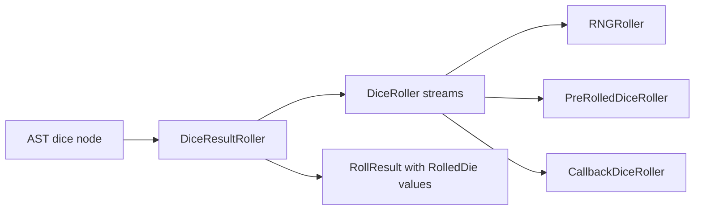

# Rollers
Active contributors: Jason

## Purpose

Rollers separate the origin of a face value from the interpretation of dice notation. A face may come from secure randomness, a deterministic queue, or an asynchronous external interaction. The AST still constructs the same [result model](results.md), so physical or rendered dice do not need a separate parser.

## Key abstractions

| Abstraction | Responsibility | Source |
|---|---|---|
| `DiceRoller` | Stream contract for ordinary faces and generic value selection | `lib/src/dice_roller.dart` |
| `RNGRoller` | Validated sampling using injectable `Random` | `lib/src/dice_roller.dart` |
| `PreRolledDiceRoller` | Consume and validate queued external integer faces | `lib/src/dice_roller.dart` |
| `CallbackDiceRoller` | Await client callbacks on demand | `lib/src/dice_roller.dart` |
| `DiceResultRoller` | Turn raw faces into typed dice and dispatch rerolls | `lib/src/dice_roller.dart` |



## Raw contract and defaults

`roll()` requests `ndice` values with `nsides` possible faces, starting at `min`. The actual interval is `min .. min + nsides - 1`, not necessarily `min .. nsides`. `rollVals<T>()` selects entries from a supplied list; repeated entries preserve weighting.

`DiceExpression.create(formula, roller: ...)` wraps the provided raw roller. Without one, the adapter creates an `RNGRoller` backed by `Random.secure()`. An explicitly supplied `Random`, such as `Random(1234)`, supports seeded tests.

The validating built-ins enforce these request limits:

| Constant | Value |
|---|---|
| `minDice` / `maxDice` | 0 / 1,000 |
| `minSides` / `maxSides` | 2 / 100,000 |
| `defaultRerollLimit` | 1,000 |

`rollVals()` checks dice count but has no ordinary-side-count check. These are request-level constraints, not a global execution budget. Explosions, compounds, penetration, nested expressions, and D66 decomposition can make many requests. The callback implementation does not inherit the built-in validation automatically.

## Queued and callback integration

A deterministic integration can pass actual face values:

```dart
final summary = await DiceExpression.create(
  '2d6+3',
  roller: PreRolledDiceRoller([6, 1]),
).roll();
// summary.total == 10
```

The queue supplies **faces**, not zero-based random indices. Ordinary requests validate each consumed value against the requested interval. Custom-value requests support integers only and require membership in the face list. Exhaustion throws `PreRolledDiceRollerExhaustedException`; invalid values throw `RangeError`. Consumption is incremental and not transactional: a failed roll does not rewind the queue.

Callbacks receive `ndice`, `nsides`, `min`, and `dieType` for ordinary dice, or the supplied values and `dieType` for generic selections. Return a `Future<List<...>>`; the implementation awaits it and yields its contents.

**Callback results are trusted.** Neither `CallbackDiceRoller` nor the typed adapter verifies returned list length, face ranges, or custom-value membership. A short D66 result can fail when the adapter indexes the two digits, while other malformed results may simply enter the result tree. Validate requests and responses inside the integration boundary. See [Input boundaries](../security.md).

## Typed requests and ordering

`DiceResultRoller.roll()` produces polyhedral dice. Fudge requests use `rollVals()` with `DieType.fudge` and six entries `[-1, -1, 0, 0, 1, 1]`. Explicit and named faces use `DieType.nvals`, preserving the face list in every die.

Each logical D66 makes a separate `roll(ndice: 2, nsides: 6, dieType: DieType.d66)` request. The adapter combines `tens * 10 + ones`, stores the two digit dice as discarded, and gives the active D66 die provenance. Supply `[6, 2]` for 62, not `[62]`. D66 is not a standard d66: only pairs of digits one through six are possible.

Evaluation consumes values left to right. Dice-valued counts/sides are evaluated before the requested pool; extra-roll operators consume their additional faces before evaluation proceeds to later sibling expressions. Do not preallocate values solely from the visible `NdM` tokens.

The adapter's `reroll()` dispatches by the original `DieType`: same polyhedral size, fudge distribution, D66 decomposition, or explicit face list. `singleVal` returns its existing value without raw randomness. During a [push](../features/push.md), planning uses current result order, which may differ from initial roll order after scoring or sorting.

## Modification and validation

Prefer implementing the two raw stream methods over duplicating AST behavior. Preserve callback error propagation; no retry or cancellation protocol is supplied. Keep RNG requests sequential if reproducible streams or external prompts matter.

Tests in `test/dart_dice_parser_test.dart` cover queued input, queue exhaustion, fudge faces, and callback request metadata. `test/parity_8_2_0_test.dart` exercises seeded outcomes, including D66. For external push input, use `rerollableDice()` with the exact lock predicate that will be passed to `reroll()`.

## Scope snapshot

`lib/src/dice_roller.dart` contains 388 physical lines. Its `origin/main` current-path history has two unique human authors, excluding automated authors and without following renames; recent human changes identify Jason. The shared three-file `test/*.dart` corpus contains 3,006 physical lines: an overlapping 7.75:1 test-to-source ratio, not roller-only coverage. Counts include comments and blanks at `5143708`.

## Key source files

| File | Start here for |
|---|---|
| `lib/src/dice_roller.dart` | Contracts, built-ins, validation, typed adapter |
| `lib/src/ast_dice.dart` | Dice requests and evaluated operands |
| `lib/src/push.dart` | Replacement request order |
| `test/dart_dice_parser_test.dart` | External-roll contract examples |
